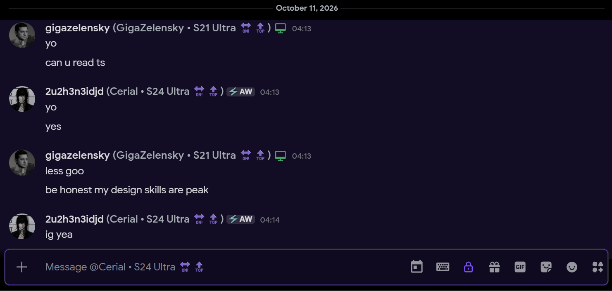
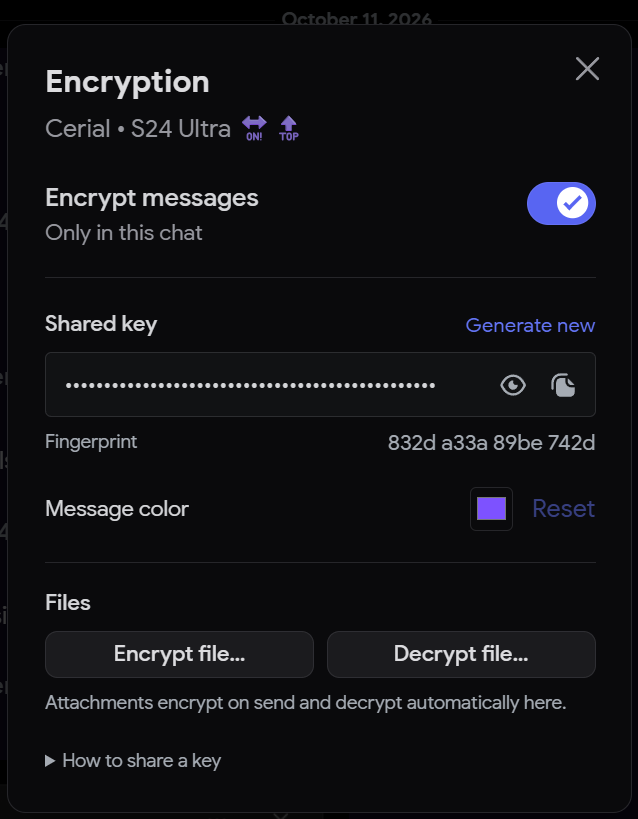

# SharedKey

Encrypt Discord messages and files, with a key for each chat.

SharedKey is a custom Vencord plugin for Windows desktop. Both people install it, then choose automatic exchange, a shared key, or a password. Discord receives encrypted text and `.vcs` files; your client decrypts them locally.

## Preview

Encrypted messages and the message box use your chat's accent color.



Right-click the lock to manage this chat's key, color, and file tools.



## Install

Install [Vencord for desktop](https://vencord.dev/download/) first.

Download a **SharedKey Windows** artifact from this repository's [Actions page](https://github.com/GigaZelensky/SharedKey/actions). Extract the ZIP, fully quit Discord from the system tray, then run `Install.ps1` in PowerShell. The installer checks the package hashes and backs up your current Vencord build. Reopen Discord after it finishes.

To compile your own build, follow [Building SharedKey](docs/building.md). Custom plugins require a Vencord source build; copying a plugin into an installed Discord folder won't load it.

## Set up a chat

1. Open the chat and right-click the lock beside the message box.
2. Choose a **Key setup** method from the options below.
3. Finish setup on both computers, then type and attach files normally.

| Method     | Setup                                                                                                                                                           |
| ---------- | --------------------------------------------------------------------------------------------------------------------------------------------------------------- |
| Automatic  | In a one-to-one DM, both people select **Automatic**. One clicks **Start exchange**. The plugins exchange public keys and an encrypted AES key through Discord. |
| Shared key | Generate a key or paste your friend's `vcs1_` key. Share it through a separate private channel and compare fingerprints.                                        |
| Password   | Enter the same non-empty text on both computers, including spaces and capitalization. Share it through a separate private channel and compare fingerprints.     |

Automatic remembers your friend's first identity key and refuses a different one until you approve the replacement. Compare the **Identity code** through another trusted channel to verify that first exchange, then choose **Mark as compared**. Private keys stay in your local protected vault. Setup packets appear as **Encryption setup** messages.

Password mode uses PBKDF2-HMAC-SHA-256 with 600,000 iterations and a separate salt for each chat. Choose a long, unique passphrase; accepting short text does not make it resistant to guessing. The password is neither sent nor saved. The derived key is saved locally so messages can decrypt without entering it again.

Switching methods restores that method's saved key and retains earlier keys for reading history. Encryption blocks sends while a newly selected method is waiting for its key. Automatic requires both people to use SharedKey 0.2.0 or newer; shared keys and passwords also work in group chats and server channels.

A closed, colored lock means encryption is on. The message box uses the same accent. Left-click the lock to turn encryption on or off for this chat. A gray, open lock means it is off. Settings and keys are saved separately for each chat; you can also manage the current chat from SharedKey's plugin settings.

## Messages and files

Type and attach files normally. SharedKey encrypts them before upload and displays decrypted messages with your chosen background color.

Replies, edits, and desktop notifications use decrypted text. Images and GIFs use Discord's attachment components and media viewer. Right-click an image to copy or save it; click a document's filename to save it. The original filename is encrypted with the file contents.

Mentions and replies to you keep Discord's yellow edge marker and add a subtle yellow tint over your accent. Discord receives no mention ping from encrypted text. Incoming messages decrypt before Discord constructs its local message records. Discord then handles their text, edit labels, reactions, attachment cards, and media viewer. Supported media links, including Discord emoji images, become native embeds after their metadata loads.

History text decrypts before its load event reaches Discord's stores, so the message list can measure plaintext on its first render. Discord's local records contain plaintext; SharedKey retains the original ciphertext separately for encryption guards and “View encrypted original.” Messages and attachments stored on Discord remain encrypted.

Media previews still need to download or resolve metadata locally, so their dimensions can arrive after the text. SharedKey supplies raw attachment and embed data to Discord's existing conversion pipeline; it does not provide a replacement message or media renderer. Website previews that require Discord's server to read the plaintext cannot be reproduced automatically.

Right-click an encrypted text message and choose **View encrypted original** to inspect its ciphertext. Turning encryption off keeps old messages readable. Replacing a key retains earlier keys for that chat.

## Limits

| Item                                             | Behavior                                                                                |
| ------------------------------------------------ | --------------------------------------------------------------------------------------- |
| Text                                             | Encryption adds length. SharedKey blocks a send that exceeds Discord's character limit. |
| Outgoing files                                   | Up to 64 MiB, within your Discord upload allowance.                                     |
| Incoming files up to 64 MiB                      | Decrypt in memory for previews and saving.                                              |
| Larger incoming files                            | Save the encrypted file, then use the [offline decryptor](docs/offline-decryption.md).  |
| Stickers, forwards, scheduled sends              | Blocked while this chat's encryption is on.                                             |
| Calls, screen sharing, reactions, slash commands | Outside SharedKey's encryption.                                                         |

Discord can still see participants, timestamps, message and file sizes, and reply relationships. Linked images and GIFs remain hosted by their original provider; previewing an encrypted link doesn't encrypt the remote resource.

SharedKey uses AES-256-GCM with random 256-bit keys or password-derived keys. It has no independent security audit or forward secrecy. Read the [security notes](SECURITY.md) before relying on it for sensitive conversations.

## Development

```sh
npm ci
npm test
npm run test:browser
```

Browser tests require Chrome; set `CHROME_PATH` if it isn't in a standard location. See [build instructions](docs/building.md), [the wire format](docs/protocol.md), and [maintenance notes](docs/maintaining.md).

GitHub Actions run tests, lint and type-check the plugin against a pinned Vencord revision, and produce a Windows package. Builds disable Vencord's automatic updater so a standard update cannot replace the custom plugin. To update Vencord, rebuild SharedKey against the new revision.

## Credits

Created by **GigaZelensky**. Inspired by the per-chat workflow of [hmerritt's BetterDiscord Discord Encryption plugin](https://github.com/hmerritt/discord-encryption). SharedKey has its own protocol and is not compatible with that plugin.

GPL-3.0-or-later. See [LICENSE](LICENSE).
